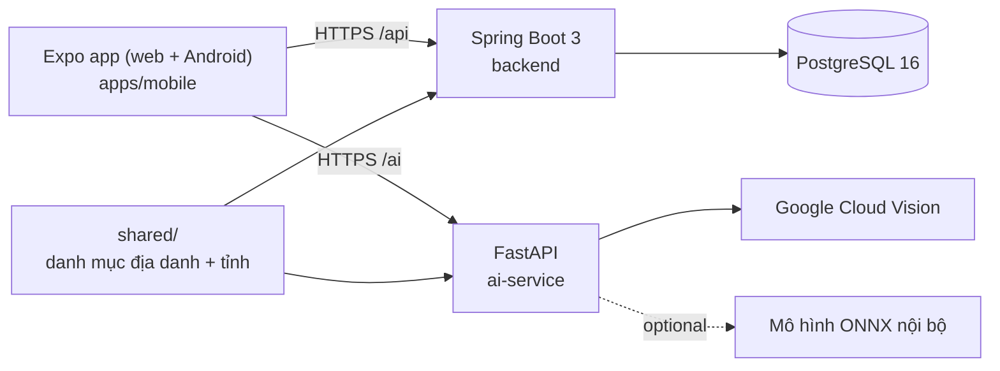

# TravelAI — nền tảng du lịch nhận diện địa danh bằng AI

Người dùng tải ảnh lên, hệ thống nhận diện địa danh (Google Cloud Vision, có thể kết hợp mô hình nội bộ tùy chọn), hiển thị mô tả, tọa độ, độ tin cậy, rồi gợi ý tour và khách sạn **cùng tỉnh** để đặt chỗ. Ngoài ra có bảng tin cộng đồng, nhắn tin thời gian thực, đánh giá và khu quản trị.

- **Bản chạy công khai:** https://travelai.minhthuan.dev
- **Bảng công việc:** [GitHub Project #2](https://github.com/users/AtelierMizumi/projects/2)
- **Đồ án môn Quản trị dự án phần mềm**, nhóm 3 kỹ sư (xem mục "Đội ngũ").

## Kiến trúc



| Thư mục | Vai trò |
|---|---|
| `apps/mobile` | Một mã nguồn Expo/React Native cho web và Android; có khu quản trị |
| `backend` | Spring Boot 3.5, Java 25: xác thực theo phiên, danh mục, đặt chỗ + thanh toán **mô phỏng**, đánh giá, bảng tin, chat WebSocket/STOMP, thống kê, cấu hình |
| `ai-service` | FastAPI: tiền xử lý ảnh, Google Vision, Wikipedia, mô hình nội bộ tùy chọn |
| `shared` | Danh mục địa danh, tỉnh và nguồn ảnh dùng chung cho backend và AI |
| `deploy`, `scripts` | Caddy, Cloudflare Tunnel, deploy agent kiểu pull (backup DB, smoke test, tự rollback), seed dữ liệu |

Bản v1 (React/Vite + `services/core` + `services/ai`) đã được đóng băng ở tag `v1-vite-core-final` và không còn nằm trong cây mã nguồn.

## Chạy thử

Cần Docker kèm `docker compose`. Các tệp khóa nằm ngoài repo (xem `.env.example`).

```bash
cp .env.example .env          # điền POSTGRES_PASSWORD, HOST_GCP_KEY, HOST_MESSAGE_KEY
docker compose up -d --build --wait postgres-v2 ai-v2 backend-v2
```

Chạy phát triển trên máy (Expo web + backend + AI): `npm run dev:web`. Hướng dẫn chi tiết: [docs/ngoc-2.0/HUONG_DAN_CHAY.md](docs/ngoc-2.0/HUONG_DAN_CHAY.md). Triển khai công khai: [docs/deploy/RUNBOOK.md](docs/deploy/RUNBOOK.md).

## Kiểm thử và CI

| Phần | Lệnh |
|---|---|
| Backend (cần PostgreSQL) | `scripts/test-backend.sh` hoặc `cd backend && ./mvnw test` |
| Ứng dụng | `cd apps/mobile && npm run lint && npm test && npx tsc --noEmit` |
| AI service | `cd ai-service && python -m unittest discover -s tests -v` |
| Stack + smoke | `scripts/smoke-edge.sh <url>` |

CI (`.github/workflows/ci.yml`) chạy 8 job gồm governance, quét secret, backend trên Postgres, ứng dụng, AI service, script triển khai, stack compose có smoke test và xuất bản image lên GHCR.

## Giới hạn đã biết

- Thanh toán là **mô phỏng** (không kết nối ngân hàng hay cổng thanh toán thật).
- Mô hình nhận diện nội bộ **không nằm trong image**: tải bằng `scripts/download-landmark-model.py` (có kiểm tra SHA-256). Khi thiếu tệp, dịch vụ chạy chỉ với Google Vision. Kết quả chỉ có mô hình luôn được ghi là *dự đoán* và không tự gắn dịch vụ theo tỉnh.
- Chưa có kiểm thử đầu-cuối tự động trên thiết bị Android thật.

## Đội ngũ

| Thành viên | Phụ trách chính |
|---|---|
| Trần Minh Thuận (`@AtelierMizumi`) | Kiến trúc, AI Vision, Docker/CI/CD, triển khai, hardening bảo mật, quản lý dự án |
| Hoàng Văn Đức (`@duchayslay`) | Backend lõi v1 (xác thực, danh mục, đặt chỗ, đánh giá, chat, quản trị), mô hình ONNX, nguyên tắc chặn xóa dịch vụ đã có đặt chỗ |
| Lê Văn Ngọc (`@ngoctapcodee`) | Giao diện v1, bản viết lại TravelAI 2.0 (Expo, backend, AI service), danh mục địa danh theo tỉnh |

Quy ước làm việc: [AGENTS.md](AGENTS.md), [COLABORATION.md](COLABORATION.md). Commit theo Conventional Commits có mã issue, nhánh `feat/wbs-<id>-<mô-tả>`.
