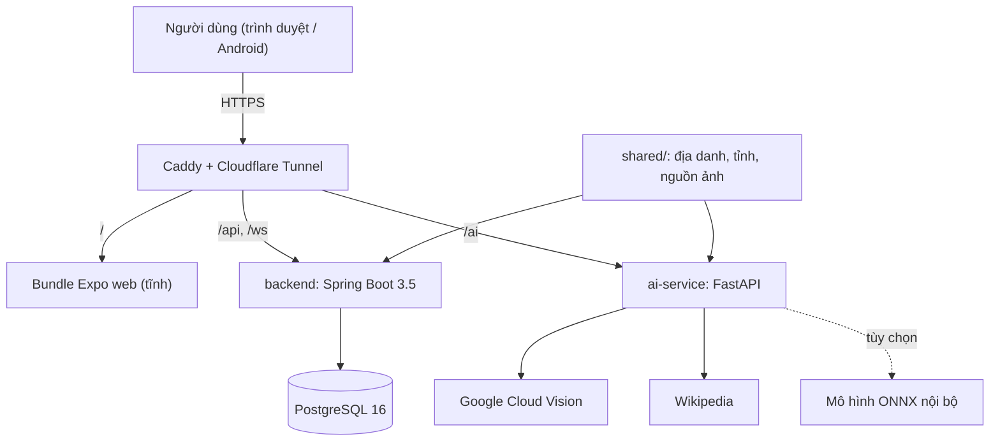

# Kiến trúc hệ thống TravelAI (WBS 1.1.2)

> **Phiên bản:** 2.0 (cập nhật 15/11/2026, theo CR-01 và biên bản 06) · **Chủ gói:** Trần Minh Thuận · **Issue:** [#2](https://github.com/AtelierMizumi/TravelAI/issues/2)
>
> Bản v1 (React/Vite, `services/core`, `services/ai`) được đóng băng ở tag `v1-vite-core-final`. Tài liệu này mô tả bản đang chạy.

## 1. Tổng quan

TravelAI là một backend Spring Boot dùng chung một PostgreSQL, một dịch vụ AI FastAPI riêng và một ứng dụng Expo chạy trên web và Android. Đây là **một monolith kèm một dịch vụ AI tách rời**, chưa phải hệ thống microservice đầy đủ.

## 2. Thành phần

| Thành phần | Công nghệ | Trách nhiệm |
|---|---|---|
| `apps/mobile` | Expo, React Native, TypeScript | Giao diện người dùng và quản trị, tải ảnh có đồng ý, đặt chỗ, bảng tin, chat |
| `backend` | Java 25, Spring Boot 3.5, JPA | Phiên đăng nhập, danh mục, đặt chỗ và thanh toán mô phỏng, đánh giá, bảng tin, chat, thống kê, cấu hình, danh mục địa danh theo tỉnh |
| `ai-service` | Python 3.12, FastAPI | Kiểm tra ảnh, Google Vision, Wikipedia, mô hình nội bộ tùy chọn |
| PostgreSQL 16 | | Dữ liệu quan hệ; sơ đồ cập nhật bằng `ddl-auto=update` kèm SQL migration `backend/src/main/resources/db` |
| Edge | Caddy, Cloudflare Tunnel | Một origin HTTPS cho web, API, WebSocket và AI |
| Triển khai | GHCR, deploy agent kiểu pull | Image theo SHA commit, sao lưu DB trước khi cập nhật, smoke test, tự rollback |

## 3. Luồng nhận diện

1. Ứng dụng chuẩn hóa ảnh (JPEG, cạnh dài tối đa 1600 px) và chỉ gửi sau khi người dùng đồng ý.
2. `POST /ai/detect` kiểm tra magic byte và giới hạn 10 MB, gọi Google Vision, bổ sung mô tả Wikipedia.
3. Nếu có mô hình nội bộ: kết quả chỉ được chấp nhận khi Google Vision hoặc chữ trong ảnh cùng xác nhận; một địa danh khác do Google trả về sẽ **phủ quyết** mô hình. Kết quả chỉ có mô hình luôn là "dự đoán".
4. Khi tên địa danh được xác nhận, ứng dụng mở trang địa điểm; backend trả tour và khách sạn **đang hoạt động cùng tỉnh** (`/api/places/{id}/services`). Địa chỉ không xác định được tỉnh thì không có dịch vụ nào bị suy đoán.

## 4. Bảo mật và vận hành

- Phiên phía máy chủ (hết hạn nhàn rỗi 24 giờ, tuyệt đối 7 ngày), mật khẩu băm PBKDF2, vai trò USER/ADMIN kiểm tra ở backend.
- CORS theo danh sách origin; API quản trị và thao tác ghi danh mục yêu cầu ADMIN; chặn xóa tour/khách sạn đã có đặt chỗ.
- Tin nhắn mã hóa khi lưu (không phải mã hóa đầu cuối); khóa nằm ngoài repo, gắn read-only vào container.
- Thanh toán chỉ là **mô phỏng**.
- Container chạy bằng người dùng không phải root; image build từ thư mục gốc repo với `.dockerignore` đệ quy chặn khóa và `service-account*.json`.
- Trạng thái đối chiếu với tiêu chuẩn mục tiêu: xem `.agents/rules/05_technical_architecture_and_code_standards.md` mục 0.
