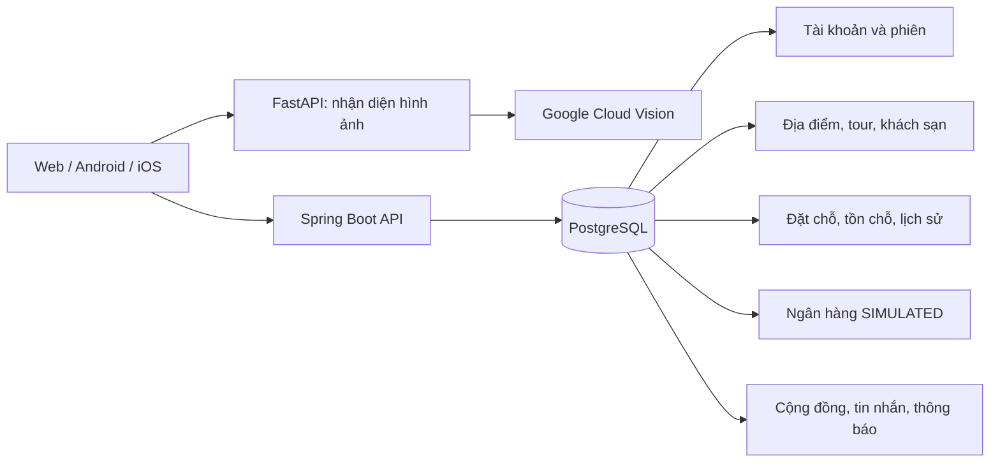

# Cơ sở dữ liệu TravelAI hiện tại

Ảnh chụp cấu trúc PostgreSQL được cập nhật ngày 08/11/2026. Tài liệu chỉ nêu cấu trúc, không bao gồm dữ liệu cá nhân, mật khẩu, khóa hay nội dung tin nhắn.

Hiện có **một PostgreSQL cho backend Spring Boot**. FastAPI nhận diện ảnh là một tiến trình riêng, không có database riêng. Đây chưa phải kiến trúc database-per-microservice. Không tự ý tách bảng đặt chỗ, tồn chỗ và ngân hàng mô phỏng: các thao tác này hiện cần một giao dịch ACID chung.

| Nhóm | Các bảng hiện có | Vai trò |
| --- | --- | --- |
| Tài khoản | `users`, `auth_sessions`, `password_reset_requests` | Người dùng, phiên đăng nhập và mã khôi phục được lưu dưới dạng HMAC |
| Danh mục | `places`, `tours`, `hotels` | Dữ liệu địa điểm và dịch vụ |
| Đặt chỗ mới | `booking_offerings`, `booking_reviews`, `booking_reservations`, `booking_allocations`, `booking_operations`, `booking_history`, `booking_barrier`, `booking_holiday_calendars` | Lịch bán, xác nhận trước thanh toán, chỗ, lịch sử và lịch lễ. `booking_reviews` là bước duyệt đặt chỗ, **không phải đánh giá sao** |
| Ngân hàng mô phỏng | `simulated_accounts`, `simulated_cards`, `simulated_transactions`, `simulated_payment_attempts` | Số dư, thẻ thử nghiệm và lịch sử SIMULATED, bao gồm các lần thanh toán thất bại |
| Cộng đồng | `posts`, `comments`, `likes`, `shares`, `follows` | Bài viết và tương tác |
| Liên hệ | `chat_messages`, `notifications` | Tin nhắn và thông báo; nội dung tin nhắn được mã hóa khi lưu |
| Đánh giá | `service_ratings` | Một đánh giá trên mỗi đặt chỗ; số sao, nội dung và ảnh công khai |
| Cũ / cấu hình | `hotel_bookings`, `tour_bookings`, `system_settings` | Lịch sử cũ và cấu hình hệ thống |

Ưu đãi theo ngày được lưu trong cấu hình `booking_offerings.definition` và chốt giá trong lịch trình đặt chỗ. Tin nhắn thoại được lưu trong nội dung mã hóa của `chat_messages`, không có bảng ghi âm riêng. Khóa mã hóa không nằm trong tài liệu này.

Sáu khách sạn có sẵn được phân loại vào `hotels.province` theo địa điểm đang lưu: Hạ Long → Quảng Ninh; Hồ Gươm → Hà Nội; Nhà thờ Đức Bà Sài Gòn → TP.HCM; Phú Quốc → An Giang; Bà Nà Hills và Hội An → Đà Nẵng. Cập nhật chỉ áp dụng khi tên, địa điểm và ID trùng khớp, và trường tỉnh chưa được điền. Nguồn địa phương: [danh mục 34 tỉnh/thành sau sắp xếp](https://vietnam.travel/things-to-do/vietnam%E2%80%99s-new-provincial-system-34-names-you-should-know/), [Hội An](https://vietnam.travel/things-to-do/have-yourself-an-eco-friendly-nature-travel-quang-nam/), [Bà Nà](https://vietnam.travel/things-to-do/explore-ba-na-hills/), [Hạ Long](https://vietnam.travel/things-to-do/ha-long-bay-cat-ba-archipelago-recognised-unesco%E2%80%99s-world-natural-heritage/), [Hồ Gươm](https://image.vietnam.travel/places-to-go/northern-vietnam/ha-noi), [Nhà thờ Đức Bà Sài Gòn](https://svhtt.hochiminhcity.gov.vn/documents/10184/256372/Danh%2Bmuc%2Bkiem%2Bke%2Bdi%2Btich%2Blich%2Bsu%2Bvan%2Bhoa%2Btren%2Bdia%2Bban%2BTPHCM%2Bgiai%2Bdoan%2B2016-2020-ph.pdf/539ee8c6-974e-4c90-a41f-bd2a18682eef), [Phú Quốc](https://cms.baochinhphu.vn/an-giang-de-nghi-cong-nhan-phu-quoc-la-khu-kinh-te-dac-biet-102261030115508357.htm). Đây là phân loại theo địa điểm trong danh mục, không xác minh địa chỉ cụ thể của từng cơ sở.

PostgreSQL hiện cảnh báo phiên bản collation của database không khớp với hệ điều hành. Cần kiểm tra các index phụ thuộc collation, lập kế hoạch sao lưu và xây dựng lại index trước khi đồng bộ phiên bản; không chạy `REFRESH COLLATION VERSION` đơn lẻ để che cảnh báo.
